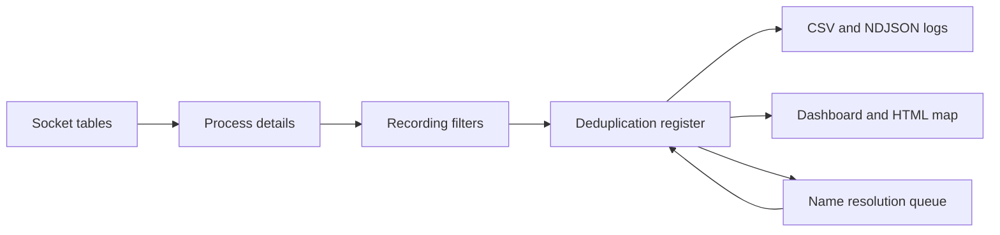

> **Language / Langue**: [English](architecture.md) · **Français**

# Fonctionnement de PortAtlas

PortAtlas enregistre avec quels services une machine communique, sur des jours ou des semaines, et quel programme en est à l'origine. Cette page explique comment l'agent obtient cette information et pourquoi il est construit ainsi. Les options et formats exacts sont dans la [référence](../reference/cli.fr.md).

## Lire les sockets plutôt que capturer les paquets

L'agent lit les tables de sockets que le système tient déjà :

- sous Windows, par l'API IP Helper (`GetExtendedTcpTable`, `GetExtendedUdpTable`), qui donne l'identifiant du processus de chaque socket ;
- sous Linux, en lisant `/proc/net/tcp`, `tcp6`, `udp` et `udp6`, puis en rapprochant l'inode de chaque socket des descripteurs de `/proc/<pid>/fd`.

Aucun pilote de capture (Npcap, libpcap) n'est installé et aucun paquet n'est lu. L'agent voit les connexions, pas leur contenu, et seulement celles ouvertes au moment d'un balayage : une connexion ouverte et fermée entre deux balayages n'est pas vue. Réduire `--interval` réduit cet écart.

Lire `/proc/<pid>/fd` d'un processus d'un autre utilisateur demande root. Sans root, les sockets de ces processus sont listés mais ne sont rattachés à aucun processus. Sous Windows, le chemin, la ligne de commande et le compte des processus d'autres comptes ne sont pas lisibles sans invite élevée ; ces champs restent alors vides.

## Le cycle de balayage

Toutes les `ScanIntervalSeconds` secondes, `FlowAuditEngine` :

1. lit les sockets par SocketForge et le processus de chaque socket par ProcessForge, qui trouve aussi l'application lancée par un lanceur comme `java -jar`, `python` ou `powershell` ;
2. écarte les sockets retenus par les filtres d'enregistrement (`NetworkFlowFilter` pour les ports, les adresses et le trafic de bouclage, `ProcessExclusionFilter` pour les processus) ;
3. transmet le reste à `ConnectionDeduplicationRegister`, qui met à jour ou crée une entrée par flux ;
4. toutes les `LogRewriteIntervalMinutes` minutes, réécrit tout le journal CSV à partir du registre, et le journal NDJSON s'il est activé.

Les journaux sont aussi réécrits une fois au démarrage, pour qu'un journal qui ne peut pas être remplacé (ouvert par un autre programme, dossier en lecture seule) arrête l'audit tout de suite avec son message, et une fois à l'arrêt de l'audit, pour conserver les observations faites depuis la dernière réécriture.

## Pourquoi dédupliquer les flux

Un client ouvre un nouveau port local à chaque connexion. Journaliser chaque connexion produirait une ligne par port et par balayage. Le registre identifie un flux sans le port client (voir les [formats de sortie](../reference/output-formats.fr.md#journal-daudit-csv)) : un service utilisé des milliers de fois garde une seule ligne, avec une date de première observation, une date de dernière observation et un compteur. Le journal est réécrit à partir du registre au lieu d'être complété, pour que sa ligne porte les dernières valeurs ; relire tout le journal au démarrage les conserve d'un redémarrage à l'autre.

## Résolution de noms

Les adresses distantes sont nommées en arrière-plan, pour qu'un serveur DNS lent ne retarde jamais un balayage. `CachedHostNameResolver` cherche d'abord le nom dans les alias statiques (`CustomHostAliases`, `--alias`), puis dans son cache mémoire et dans le fichier de cache (`DnsCacheFilePath`). Il ignore les adresses de `DnsExcludedNetworks` (diffusion, multidiffusion, lien local) et met les autres en file. Dix résolutions au plus tournent en même temps, et chaque requête DNS inverse attend au plus `DnsResolutionTimeoutMs` (3 secondes par défaut).

Pour une adresse publique, le résolveur demande aussi au service RDAP `rdap.org` quelle organisation possède le bloc d'adresses, sauf si `ResolveIpOwners` vaut `false` ou si `--no-rdap` est donné. Le nom DNS reste prioritaire : l'organisation ne s'affiche que pour une adresse sans nom DNS. Après deux échecs RDAP consécutifs, le résolveur suspend RDAP pendant 60 secondes.

Si le serveur DNS ne répond pas dans le délai, rien n'est mis en cache et l'adresse est reposée une minute plus tard. S'il répond qu'aucun enregistrement n'existe, l'adresse est mise en cache avec un nom vide et reposée 24 heures plus tard, pour qu'un enregistrement ajouté ensuite à la zone finisse par être trouvé. Une requête RDAP restée sans réponse laisse hors du cache une adresse sans nom DNS, met en cache sans organisation une adresse qui en a un, et repose l'adresse 15 minutes plus tard.

À l'expiration de son délai, le résolveur remet en file une adresse restée sans réponse, même si plus aucun balayage ne voit la connexion. Il le fait trois fois au plus, pour qu'un serveur coupé d'Internet n'interroge pas sans fin pour des flux disparus. Au-delà, l'adresse ne repart en file que si un balayage la revoit. Le compte repart de zéro dès qu'elle obtient une réponse.

Au démarrage, un flux relu du journal d'audit sans nom prend celui du cache, ou part en file s'il n'y en a pas.

`--no-dns` (`ResolveRemoteHostNames: false`) coupe tout le résolveur : aucune requête DNS ni RDAP n'est envoyée et les alias ne s'appliquent pas.

`--no-rdap` existe pour les serveurs sans accès Internet : RDAP n'y ferait qu'expirer, alors que le DNS inverse atteint toujours le serveur DNS local. `resolve` complète les noms plus tard sur une machine connectée, et `resolve --cache-only` travaille à partir des caches collectés sans envoyer de requête.

## Frameworks partagés

Le programme est réparti entre l'application et quatre frameworks publiés en paquets NuGet, réutilisés par d'autres projets :

| Paquet | Rôle dans PortAtlas |
| :--- | :--- |
| SocketForge 2.1.1 | Tables de sockets (IPv4 et IPv6) sous Windows et Linux |
| ProcessForge 1.3.1 | Informations et compte des processus, cibles des lanceurs, exclusion de processus |
| FileForge.Core 1.4.1 | Lecture des enregistrements RFC 4180, et remplacement d'un fichier seulement une fois sa nouvelle version complète (journaux d'audit, configuration, profils, cache DNS) |
| TopologyForge 1.13.0 | Graphe topologique, filtres, carte HTML et export Draw.io |

L'application contient ce qui est propre à l'audit : `PortAtlas.Core` contient le cycle de balayage, la déduplication, la résolution de noms et les exports ; `PortAtlas.Cli`, compilé en exécutable `PortAtlas`, contient la ligne de commande, le fichier de configuration et le tableau de bord. L'interface graphique est dans `PortAtlas.Gui.Core` et `PortAtlas.Gui`.

## Ligne de commande

Chaque commande déclare les options qu'elle lit avec System.CommandLine ; les mêmes définitions produisent l'analyseur et le texte d'aide. Les raisons de ce choix sont consignées dans l'[ADR-0001](../adr/0001-system-commandline-subcommands.md).

## Commandes qui travaillent à partir des journaux

`audit` est la seule commande qui lit les tables de sockets. `map`, `export` et `resolve` travaillent à partir des fichiers qu'il a écrits, sur n'importe quelle machine :

- `map`, `export rules` et `export ndjson` lisent des journaux d'audit et écrivent une carte, des matrices de règles ou un fichier NDJSON. Elles n'envoient aucune requête réseau.
- `resolve` fusionne les caches DNS collectés sur plusieurs serveurs, envoie les requêtes DNS et RDAP que l'audit n'a pas pu envoyer, et écrit des copies des journaux avec les noms complétés. Elle est prévue pour une machine qui a accès à Internet ; voir [Auditer des serveurs sans accès Internet](../how-to/audit-isolated-servers.fr.md).
- `lookup` déroule pour une adresse les étapes de résolution de l'audit et affiche chacune d'elles, sans écrire dans le cache ; voir [Diagnostiquer un nom d'hôte manquant](../how-to/diagnose-name-resolution.fr.md).

L'interface graphique ne contient aucune logique d'audit : elle lit l'arbre des commandes de `PortAtlas.Cli` pour construire ses formulaires, et lance l'exécutable `PortAtlas` comme processus enfant avec la ligne de commande construite à partir d'un formulaire. [Comment l'interface graphique est construite](gui-architecture.fr.md) explique pourquoi.

## Modèle de sécurité

| Aspect | Comportement |
| :--- | :--- |
| Trafic réseau | L'agent envoie des requêtes DNS inverses et, pour les adresses publiques, des requêtes RDAP à `rdap.org`. `--no-rdap` désactive RDAP ; `--no-dns` désactive les deux. `resolve` envoie les mêmes requêtes, selon `ResolveRemoteHostNames` et `ResolveIpOwners`, et aucune avec `--cache-only` ; `lookup` les envoie pour l'adresse donnée, quels que soient ces réglages. Aucune commande ne se connecte aux machines auditées. |
| Modifications de la machine | `audit` écrit ses journaux, le cache DNS et les cartes demandées (`--html`, `--drawio`, la touche `M` du tableau de bord), et une exclusion faite depuis le tableau de bord ajoute la valeur au fichier de configuration ([détails](../reference/dashboard.fr.md#exclure-depuis-le-tableau-de-bord)). Les autres commandes n'écrivent que leurs fichiers de sortie, décrits dans la [référence de la CLI](../reference/cli.fr.md) ; l'interface graphique enregistre aussi ses profils et ses préférences. Aucun pilote, service ni règle de pare-feu n'est installé ; les tables de sockets et de processus sont seulement lues. |
| Privilèges | Administrateur ou root est nécessaire pour rattacher chaque socket à son processus (voir plus haut). |
| Données collectées | Les lignes de commande peuvent contenir des secrets passés en argument ; protégez les journaux en conséquence. |
| Captures d'écran | `--mask-server`, `--mask-ip` et `--obfuscate` masquent le nom et l'adresse du serveur dans le tableau de bord uniquement. |
