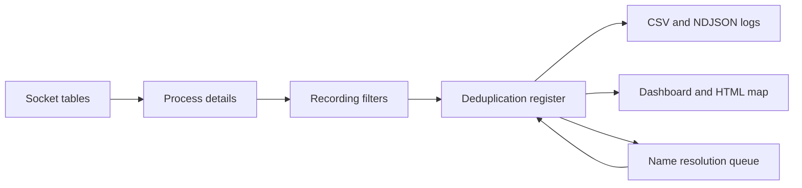

> **Language / Langue**: **English** · [Français](architecture.fr.md)

# How PortAtlas works

PortAtlas records which services a machine talks to, over days or weeks, and which program is responsible. This page explains how the agent collects that information and why it is built this way. The exact options and formats are in the [reference](../reference/cli.md).

## Reading sockets instead of capturing packets

The agent reads the socket tables the operating system already keeps:

- on Windows, through the IP Helper API (`GetExtendedTcpTable`, `GetExtendedUdpTable`), which gives the process identifier of each socket;
- on Linux, by reading `/proc/net/tcp`, `tcp6`, `udp` and `udp6`, then matching each socket inode with the descriptors in `/proc/<pid>/fd`.

No capture driver (Npcap, libpcap) is installed and no packet is read. The agent sees connections, not their content, and only those open at the moment of a scan: a connection that opens and closes between two scans is not seen. Lowering `--interval` reduces that gap.

Reading `/proc/<pid>/fd` of another user's process needs root. Without it, the sockets of those processes are still listed but are not attributed to a process. On Windows, the path, command line and account of processes of other accounts cannot be read without an elevated prompt; those fields then stay empty.

## The scan cycle

Every `ScanIntervalSeconds` seconds, `FlowAuditEngine`:

1. reads the sockets through SocketForge and the process of each socket through ProcessForge, which also finds the application started by a launcher such as `java -jar`, `python` or `powershell`;
2. drops the sockets matched by the recording filters (`NetworkFlowFilter` for ports, addresses and loopback traffic, `ProcessExclusionFilter` for processes);
3. hands the rest to `ConnectionDeduplicationRegister`, which updates or creates one entry per flow;
4. every `LogRewriteIntervalMinutes` minutes, rewrites the whole CSV log from the register, and the NDJSON log when enabled.

The logs are also rewritten once at startup, so that a log that cannot be replaced (held open by another program, read-only folder) stops the audit at once with its message, and once when the audit stops, so that the observations made since the last rewrite are kept.

## Why flows are deduplicated

A client opens a new local port for each connection. Logging every connection would produce one line per port and per scan. The register identifies a flow without the client port (see [output formats](../reference/output-formats.md#csv-audit-log)), so that a service used thousands of times keeps one line with a first-seen date, a last-seen date and an observation count. The log is rewritten from the register rather than appended to, so that its line carries the latest values; reading the whole log at startup keeps them across restarts.

## Name resolution

Remote addresses are named in the background so that a slow DNS server never delays a scan. `CachedHostNameResolver` looks the name up first in the static aliases (`CustomHostAliases`, `--alias`), then in its memory cache and in the cache file (`DnsCacheFilePath`). It skips the addresses of `DnsExcludedNetworks` (broadcast, multicast, link-local) and queues the others. Ten resolutions run at most at the same time, and each reverse DNS query waits at most `DnsResolutionTimeoutMs` (3 seconds by default).

For a public address, the resolver also asks the RDAP service `rdap.org` which organisation owns the address block, unless `ResolveIpOwners` is `false` or `--no-rdap` is given. The DNS name comes first: the organisation is shown only for an address without a DNS name. After two consecutive RDAP failures, the resolver pauses RDAP for 60 seconds.

If the DNS server does not answer in time, nothing is cached and the address is asked again one minute later. If it answers that no record exists, the address is cached with an empty name and asked again 24 hours later, so that a record added later to the zone is eventually found. An RDAP query left without answer keeps an address without a DNS name out of the cache, caches an address that has one without organisation, and asks again 15 minutes later.

Once its delay has passed, the resolver queues again an address left without answer, even when no scan sees the connection any more. It does so three times at most, so that a server cut off from the Internet does not keep querying for flows that are gone. After that, the address is queued again only when a scan sees it. The count starts over once it gets an answer.

At startup, a flow reloaded from the audit log without a name takes the one held in the cache, or is queued when the cache has none.

`--no-dns` (`ResolveRemoteHostNames: false`) turns the whole resolver off: neither DNS nor RDAP queries are sent, and aliases are not applied.

`--no-rdap` exists for servers without Internet access: RDAP would only time out there, while reverse DNS still reaches the local DNS server. `resolve` completes the names later on a connected machine, and `resolve --cache-only` works from collected caches without sending any query.

## Shared frameworks

The program is split between the application and four frameworks published as NuGet packages, reused by other projects:

| Package | Role in PortAtlas |
| :--- | :--- |
| SocketForge 2.1.1 | Socket tables (IPv4 and IPv6) on Windows and Linux |
| ProcessForge 1.3.1 | Process details and account, launcher targets, process exclusion |
| FileForge.Core 1.4.1 | Reading of RFC 4180 records, and replacement of a file only once its new version is complete (audit logs, configuration, profiles, DNS cache) |
| TopologyForge 1.13.0 | Topology graph, filters, HTML map and Draw.io export |

The application holds what is specific to the audit: `PortAtlas.Core` holds the scan cycle, deduplication, name resolution and the exports; `PortAtlas.Cli`, built as the `PortAtlas` executable, holds the command line, the configuration file and the dashboard. The graphical interface is in `PortAtlas.Gui.Core` and `PortAtlas.Gui`.

## Command line

Each command declares the options it reads with System.CommandLine; the same definitions produce the parser and the help text. The reasons for this choice are recorded in [ADR-0001](../adr/0001-system-commandline-subcommands.md).

## Commands that work from the logs

`audit` is the only command that reads the socket tables. `map`, `export` and `resolve` work from the files it wrote, on any machine:

- `map`, `export rules` and `export ndjson` read audit logs and write a map, rule matrices or an NDJSON file. They send no network query.
- `resolve` merges the DNS caches collected from several servers, sends the DNS and RDAP queries the audit could not send, and writes copies of the logs with the names filled in. It is meant for a machine with Internet access; see [Audit servers without Internet access](../how-to/audit-isolated-servers.md).
- `lookup` runs the resolution steps of the audit for one address and prints each of them, without writing to the cache; see [Diagnose a missing host name](../how-to/diagnose-name-resolution.md).

The graphical interface holds no audit logic: it reads the command tree of `PortAtlas.Cli` to build its forms, and runs the `PortAtlas` executable as a child process with the command line built from a form. [How the graphical interface is built](gui-architecture.md) explains why.

## Security model

| Aspect | Behaviour |
| :--- | :--- |
| Network traffic | The agent sends reverse DNS queries and, for public addresses, RDAP queries to `rdap.org`. `--no-rdap` disables RDAP; `--no-dns` disables both. `resolve` sends the same queries, following `ResolveRemoteHostNames` and `ResolveIpOwners`, and none with `--cache-only`; `lookup` sends them for the address it is given, whatever these settings. No command connects to the audited peers. |
| Changes to the machine | `audit` writes its logs, the DNS cache and the maps it is asked for (`--html`, `--drawio`, the `M` key of the dashboard), and an exclusion made from the dashboard adds the value to the configuration file ([details](../reference/dashboard.md#excluding-from-the-dashboard)). The other commands write only their output files, listed in the [CLI reference](../reference/cli.md); the graphical interface also saves its profiles and preferences. No driver, service or firewall rule is installed; socket and process tables are only read. |
| Privileges | Administrator or root is needed to attribute every socket to its process (see above). |
| Collected data | Command lines can contain secrets passed as arguments; protect the audit logs accordingly. |
| Screenshots | `--mask-server`, `--mask-ip` and `--obfuscate` hide the server name and address in the dashboard only. |
