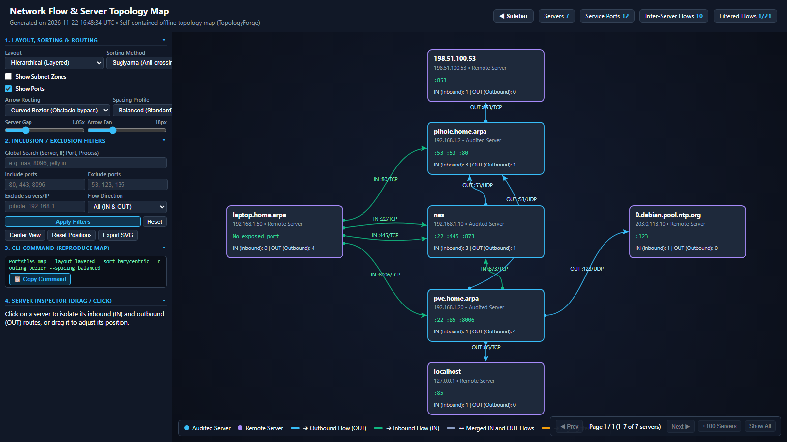

> **Language / Langue**: [English](getting-started.md) · **Français**

# Premiers pas

Ce tutoriel lance un premier audit sur votre machine et le transforme en carte topologique. Comptez une dizaine de minutes.

## Télécharger

Sur la [page des versions](https://github.com/curvecoder/PortAtlas/releases), téléchargez l'archive de votre système et décompressez-la dans un dossier :

- Windows : `PortAtlas-<version>-win-x64.zip`
- Linux : `PortAtlas-<version>-linux-x64.tar.gz`

L'exécutable est autonome : aucun runtime .NET n'est nécessaire. L'archive contient aussi un fichier `portatlas.json` avec les réglages par défaut.

## Lancer un premier audit

Ouvrez un terminal dans ce dossier, en administrateur sous Windows.

Windows (PowerShell) :

```powershell
.\PortAtlas.exe audit
```

Linux :

```bash
chmod +x ./PortAtlas
sudo ./PortAtlas audit
```

Le tableau de bord s'ouvre. Toutes les cinq secondes, il liste les flux trouvés : le programme, l'adresse et le port distants, et le nom résolu pour cette adresse. Ouvrez une page web ou lancez `git fetch` dans une autre fenêtre : de nouveaux flux apparaissent en quelques secondes.

## Lire le tableau de bord

Le terminal doit faire au moins 100 colonnes et 16 lignes ; une fenêtre plus petite n'affiche que `Window too small` jusqu'à ce qu'elle soit agrandie.

- L'en-tête nomme la machine, son adresse, l'intervalle de scan et l'heure.
- METRICS compte les sockets du dernier scan, les flux enregistrés par cet audit et les nouveaux flux du dernier scan ; NETWORK TRAFFIC BREAKDOWN et TOP ACTIVE PROCESSES (AUDITED) comptent les sockets du dernier scan.
- Le tableau en dessous, `AUDIT LOG (DISCOVERIES)`, contient une ligne par flux, le plus récent en premier. `TIME` est l'heure à laquelle le flux a été vu pour la première fois, en UTC. `DIR` vaut `OUT` pour une connexion ouverte par la machine, `IN` pour une connexion qu'elle a acceptée, `LIST` pour un port en écoute. `REMOTE` montre l'adresse tant que le nom n'est pas résolu, puis le nom. `PROCESS` est le programme, et `TARGET / CMD` l'application qu'il exécute (un `.jar`, un script `.py` ou `.ps1`) ou, à défaut, sa ligne de commande.
- Le pied de page liste les touches. `V` passe à `ACTIVE SOCKETS (SNAPSHOT)`, tous les sockets du dernier scan avant les filtres ; `V` à nouveau revient. `N` et `P` tournent les pages.

Appuyez sur `M` : le tableau de bord écrit une première carte, `portatlas_topology.html`, à partir des flux enregistrés jusque-là. Ouvrez-la dans un navigateur ; [Dessiner la carte](#dessiner-la-carte), plus bas, dessine le même genre de carte à partir du journal, sans que l'audit tourne.

Les flèches sélectionnent une cellule et `Entrée` exclut sa valeur de l'audit, en l'enregistrant dans `portatlas.json` ; gardez cela pour plus tard. Chaque zone, touche et message est décrit dans la [référence du tableau de bord](reference/dashboard.fr.md).

Laissez l'audit tourner quelques minutes, puis appuyez sur `Q`. Les flux sont maintenant dans `portatlas_audit.csv`.

## Où vont les fichiers

PortAtlas écrit ses fichiers dans le dossier de travail, celui où se trouve le terminal, et non dans le dossier de l'exécutable : `portatlas_audit.csv`, le cache DNS `portatlas_dns_cache.json` et les cartes. Il lit `portatlas.json` d'abord dans le dossier de travail, puis dans le dossier de l'exécutable. Dans ce tutoriel, le terminal a été ouvert dans le dossier de l'exécutable : tout se trouve au même endroit.

Lancé depuis un autre dossier, comme `C:\Tools\PortAtlas\PortAtlas.exe audit` depuis `C:\Users\me`, l'audit lit toujours `C:\Tools\PortAtlas\portatlas.json`, mais écrit `portatlas_audit.csv` dans `C:\Users\me`. Pour garder les fichiers au même endroit, ouvrez le terminal à cet endroit, ou donnez des chemins absolus à `OutputCsvPath` et `DnsCacheFilePath` dans le [fichier de configuration](reference/configuration.fr.md).

## Dessiner la carte

Windows :

```powershell
.\PortAtlas.exe map --html first_map.html
```

Linux :

```bash
./PortAtlas map --html first_map.html
```

La commande affiche `Topology map generated: …` avec le nombre de serveurs et de flux. Ouvrez `first_map.html` dans un navigateur : votre machine apparaît avec les serveurs auxquels elle a parlé. La page fonctionne hors ligne.

À titre de comparaison, voici la carte du [homelab d'exemple](examples/homelab/README.fr.md), dont les journaux des trois serveurs sont lus ensemble par `PortAtlas map -i logs --html homelab.html`. Chaque boîte est une machine avec les ports qu'elle offre ; une flèche bleue est un flux que la machine a ouvert, une flèche verte un flux qu'elle a accepté, avec le port et le protocole.



## Et ensuite

- Faire tourner l'audit en permanence : [Exécuter PortAtlas en service](how-to/run-as-a-service.fr.md).
- Construire une carte pour plusieurs serveurs : [Cartographier plusieurs machines](how-to/map-several-machines.fr.md).
- Toutes les commandes et options : [référence de la ligne de commande](reference/cli.fr.md).
