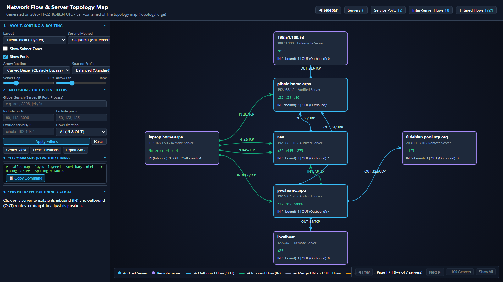

> **Language / Langue**: **English** · [Français](getting-started.fr.md)

# Getting started

This tutorial runs a first audit on your machine and turns it into a topology map. It takes about ten minutes.

## Download

From the [releases page](https://github.com/curvecoder/PortAtlas/releases), download the archive for your system and extract it into a folder:

- Windows: `PortAtlas-<version>-win-x64.zip`
- Linux: `PortAtlas-<version>-linux-x64.tar.gz`

The executable is self-contained: no .NET runtime is needed. The archive also holds a `portatlas.json` file with the default settings.

## Run a first audit

Open a terminal in that folder, as administrator on Windows.

Windows (PowerShell):

```powershell
.\PortAtlas.exe audit
```

Linux:

```bash
chmod +x ./PortAtlas
sudo ./PortAtlas audit
```

The dashboard opens. Every five seconds it lists the flows found: the program, the remote address and port, and the name resolved for that address. Open a web page or run `git fetch` in another window: new flows appear within a few seconds.

## Read the dashboard

The terminal needs at least 100 columns and 16 rows; a smaller window shows only `Window too small` until it is enlarged.

- The header names the machine, its address, the scan interval and the clock.
- METRICS counts the sockets of the last scan, the flows recorded by this audit and the new flows of the last scan; NETWORK TRAFFIC BREAKDOWN and TOP ACTIVE PROCESSES (AUDITED) count the sockets of the last scan.
- The table below, `AUDIT LOG (DISCOVERIES)`, holds one row per flow, newest first. `TIME` is the time the flow was first seen, in UTC. `DIR` is `OUT` for a connection the machine opened, `IN` for one it accepted, `LIST` for a listening port. `REMOTE` shows the address until the name is resolved, then the name. `PROCESS` is the program, and `TARGET / CMD` the application it runs (a `.jar`, a `.py` or `.ps1` script) or, when there is none, its command line.
- The footer lists the keys. `V` switches to `ACTIVE SOCKETS (SNAPSHOT)`, every socket of the last scan before the filters; `V` again comes back. `N` and `P` turn the pages.

Press `M`: the dashboard writes a first map, `portatlas_topology.html`, from the flows recorded so far. Open it in a browser; [Render the map](#render-the-map) below draws the same kind of map from the log, without the audit running.

The arrows select a cell and `Enter` excludes its value from the audit, and saves it to `portatlas.json`; leave that for later. Every area, key and message is described in the [terminal dashboard reference](reference/dashboard.md).

Leave the audit running for a few minutes, then press `Q`. The flows are now in `portatlas_audit.csv`.

## Where the files go

PortAtlas writes its files in the working directory, the folder the terminal is in, not in the folder of the executable: `portatlas_audit.csv`, the DNS cache `portatlas_dns_cache.json` and the maps. It reads `portatlas.json` from the working directory first, then from the folder of the executable. In this tutorial the terminal was opened in the folder of the executable, so everything sits together.

Run from another folder, as in `C:\Tools\PortAtlas\PortAtlas.exe audit` from `C:\Users\me`, the audit still reads `C:\Tools\PortAtlas\portatlas.json`, but writes `portatlas_audit.csv` to `C:\Users\me`. To keep the files in one place, open the terminal in that place, or give absolute paths to `OutputCsvPath` and `DnsCacheFilePath` in the [configuration file](reference/configuration.md).

## Render the map

Windows:

```powershell
.\PortAtlas.exe map --html first_map.html
```

Linux:

```bash
./PortAtlas map --html first_map.html
```

The command prints `Topology map generated: …` with the number of servers and flows. Open `first_map.html` in a browser: your machine sits in the map with the servers it talked to. The page works offline.

For comparison, here is the map of the [example homelab](examples/homelab/README.md), whose three server logs are read together by `PortAtlas map -i logs --html homelab.html`. Each box is a machine with the ports it offers; a blue arrow is a flow the machine opened, a green arrow a flow it accepted, labelled with the port and protocol.



## Next steps

- Run the audit permanently: [Run PortAtlas as a service](how-to/run-as-a-service.md).
- Build one map for several servers: [Map several machines](how-to/map-several-machines.md).
- Every command and option: [command-line reference](reference/cli.md).
